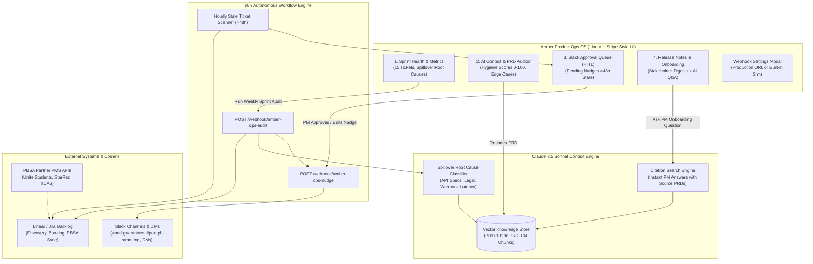

# amber // Product & AI Operations OS

> **Executive Product & AI Operations Control Tower tailored for Amber** — the global student accommodation marketplace.

Built for product leaders, engineering managers, and product operations teams across the **Pune Product Org (3 Active Pods)** to automate sprint spillover root-cause analysis, audit PRD context hygiene, manage Human-In-The-Loop (HITL) Slack alerts, and ramp new PMs with instant AI context citations.

---

## 🏗 Architecture & Data Flow



---

## 🚀 Key Feature Modules

### 1. Sprint Health & Metrics (Default View)
- **Executive KPI Cards with Week-over-Week Deltas:**
  - **Sprint Spillover Rate:** `11.4%` (-6.2% vs W46 • Target: <12%)
  - **Idea-to-Release Cycle Time:** `6.4 days` (-1.8 days • Org Avg: 8.2d)
  - **PM Admin Hours Saved:** `4.2 hrs/week` per PM (via n8n + Claude workflows)
  - **Recurring Queries Resolved by Bot:** `76%` (48/63 Slack questions without PM interruption)
- **Interactive Pod Filter:**
  - `All Pods` (15 tickets)
  - `Student Discovery` (Multi-currency rent calculators, campus commute matrices, lease duration filters)
  - `Booking & Guarantors` (UK guarantor OCR, No-Visa No-Pay refund automation, council tax validation)
  - `Supply & PBSA Sync` (Unite Students v2 API, iQ webhooks, StarRez/TCAS PMS sync, Scape RTBA bonds)
- **15 Authentic Sprint Tickets Table:**
  - Story points, status, hours stale (highlighting items >48h), PRD hygiene scores, and AI-classified spillover root causes.
- **Run Weekly Sprint Audit (n8n):**
  - Triggers the configured n8n webhook (or runs a 1.5-second animated step-by-step agent trace).
  - Displays the generated **Executive Slack Digest** in a Slack-style dark preview box with 1-click clipboard copy.

### 2. AI Context & PRD Auditor
- Audits 4 realistic Amber PRDs:
  - `PRD-101`: UK Student Guarantor Verification & Rent Guarantee Flow (`58/100` — Critical Gaps)
  - `PRD-102`: Unite Students & iQ Real-Time Inventory & Price Sync Engine (`72/100` — Needs Attention)
  - `PRD-103`: Multi-Currency Student Escrow & Instant Refund Engine (`92/100` — High Hygiene)
  - `PRD-104`: Amber AI Roommate Compatibility & Lifestyle Matching (`43/100` — Critical Gaps)
- Flags missing edge cases (e.g. *CAS withdrawal under Home Office SMS rules*, *Unite 429 rate limit backoff*, *GDPR Article 9 for teen lifestyle profiling*).
- Interactive **"Re-index PRD in Vector DB"** button that refreshes semantic embeddings in real time.

### 3. Slack Approval Queue (Human-In-The-Loop)
- Displays automated Slack nudges drafted by n8n for tickets stale >48 hours or blocked by third-party services.
- **Interactive Actions:**
  - **Approve & Send Nudge:** Dispatches directly to Slack via n8n and logs the action in real time.
  - **Edit Message:** Opens a modal to modify draft text and target channel (`#pod-guarantors-alerts`, `@pooja`, etc.) before dispatching.
  - **Dismiss:** Suppresses alerts for approved sprint exceptions.
- **Live Audit Feed:** Timestamped log tracking every PM approval, edit, and webhook response.

### 4. Release Notes Generator & PM Onboarding Ramp
- **Weekly Stakeholder Release Notes:**
  - Auto-compiled from completed sprint tickets with impact metrics (`+14.2% checkout conversion`, `-22% drop-off`).
  - Audience toggles (`All Updates`, `Customer-Facing Only`, `Internal Platform Ops`).
  - **"Copy for Slack / Notion"** with 1-click clipboard formatting.
- **New PM / APM Onboarding Ramp Tracker:**
  - Week 1 & 2 interactive checklist with real-time completion progress tracking.
  - **AI Context Q&A Search:** Type questions like *"How does PBSA inventory sync work?"* or *"What is No-Visa No-Pay?"* to receive instantaneous cited answers linked directly to indexed PRDs.

---

## 💻 Tech Stack & Design System

- **Framework:** React 18 + TypeScript + Vite
- **Styling:** Tailwind CSS with custom Amber brand theme:
  - Signature Warm Coral-Red: `#ED3A56` (hover `#D82945`, soft tint `#FFF1F3`)
  - Warm Slate Surfaces: `#F8FAFC` & crisp white card elevations
  - Fonts: Inter (UI) & JetBrains Mono (metrics, ticket keys, Slack code blocks)
- **Icons:** Lucide React
- **Deployment:** Pre-configured with Vite `base: '/amber-ops-os/'` for seamless GitHub Pages hosting.

---

## 🛠 Local Development Setup

### Prerequisites
- Node.js `v18+` or `v20+`
- npm or pnpm

### 1. Clone & Install
```bash
git clone https://github.com/your-org/amber-ops-os.git
cd amber-ops-os
npm install
```

### 2. Start Local Dev Server
```bash
npm run dev
```
Open your browser at `http://localhost:5173/amber-ops-os/`.

### 3. Build for Production / GitHub Pages
```bash
npm run build
```
The optimized static distribution will be generated in `/dist` ready to be served from any static host or deployed to GitHub Pages via Actions.

### 4. Preview Production Build
```bash
npm run preview
```
Serves the built bundle at `http://localhost:4173/amber-ops-os/`.

---

## 🔌 n8n Webhook Integration Guide

1. Click the **"Webhook Settings"** button in the top navigation header.
2. Enter your production n8n webhook URL:
   ```
   https://n8n.your-domain.com/webhook/amber-ops-audit
   ```
3. *(Optional)* Add a Bearer Token / Secret Key for authentication.
4. Click **"Test Ping"** to verify connectivity.
5. If left blank, the built-in simulator automatically handles all audit traces and Slack dispatches with zero external dependencies, making it 100% testable out-of-the-box!

---

## 👥 Product Pods (Pune Product Org)

| Pod Name | Scope & Domain Focus | Key PMS Integrations |
| :--- | :--- | :--- |
| **Student Discovery** | Search filters, campus commute matrix, multi-currency pricing, roommate matching | Google Places, TfL Tube API, Wise Platform |
| **Booking & Guarantors** | UK cosigner verification, Open Banking KYC, No-Visa No-Pay deposit escrow | Plaid, AWS Textract, Stripe Treasury |
| **Supply & PBSA Sync** | Real-time bed availability, automated tenancy contracts, flash clearance | Unite Students v2, StarRez, Kinetic, TCAS, Scape RTBA |

---

*Engineered with ❤️ for Amber by Ayushman*
